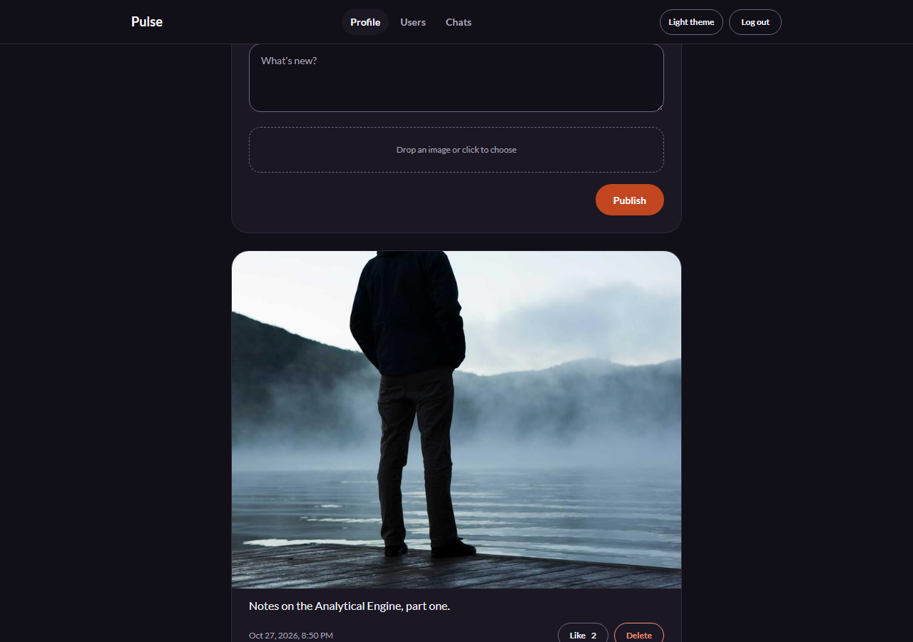
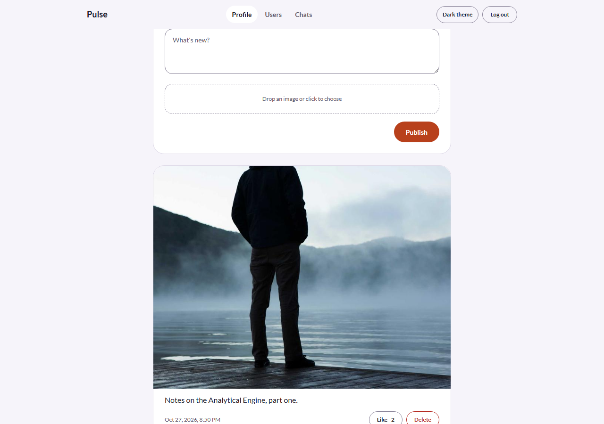
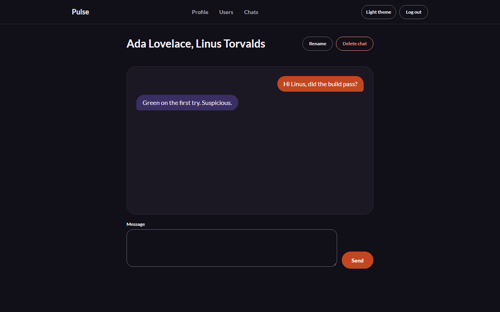
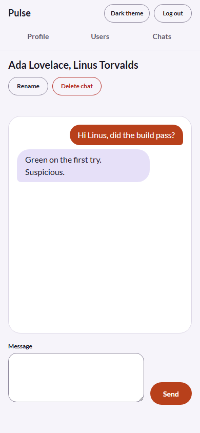
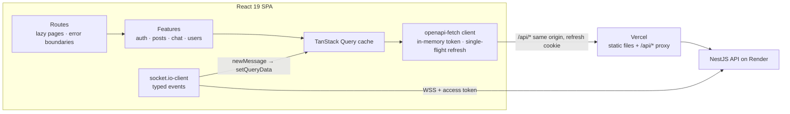

<h1 align="center">Pulse — web</h1>

<p align="center">
  The React client of Pulse, a real-time social network: profiles, image posts, likes and live chat.
</p>

<p align="center">
  <a href="https://github.com/ouvarov/viteSocialNetwork-/actions/workflows/ci.yml"></a>
  <a href="https://pulse-social-henna.vercel.app"></a>
  
</p>

**Live demo:** https://pulse-social-henna.vercel.app. Sign in as `ada@example.com` / `pulse-demo-password`. To chat with yourself, open a second window as `linus@example.com`.

> The free API host sleeps after 15 minutes idle. The app shows a "waking up" notice, and the first load can take about a minute. Demo data resets nightly at 03:00 UTC.

The API lives in [ouvarov/nestSocialNetwork](https://github.com/ouvarov/nestSocialNetwork) (NestJS, PostgreSQL, Redis, Socket.IO).

| Dark                                                            | Light                                                                                              |
| --------------------------------------------------------------- | -------------------------------------------------------------------------------------------------- |
|  |                                   |
|             |  |

## Features

- **Session handling:**
  - the access token lives in memory only;
  - the session is restored from the refresh cookie on load;
  - requests that hit a 401 together share one refresh;
  - logout clears the query cache and closes the socket.
- **Feed:**
  - infinite scroll;
  - optimistic likes that roll back on errors and survive fast double clicks;
  - posts with drag-and-drop image upload and a preview.
- **Live chat:**
  - Socket.IO messages are written straight into the TanStack Query cache;
  - after a reconnect, the chat rejoins its room and reloads the history, so nothing is lost;
  - sends wait for the server's ack with a timeout, and an offline state is shown;
  - on an expired token, the client refreshes and reconnects.
- **Routing:**
  - every page is a lazy chunk;
  - a progress bar shows while a chunk loads;
  - errors are caught per route, and failed chunks recover with a reload;
  - unknown URLs get a 404 page.
- **Design system:**
  - SCSS token maps become CSS custom properties;
  - light and dark themes, with no flash on load;
  - Stylelint bans raw colors outside the theme file.
- **Accessibility:**
  - axe finds no violations on any page in either theme;
  - skip link, and focus moves to `<main>` on navigation;
  - reduced-motion support.
- **Typed API:**
  - types are generated from the API's OpenAPI spec, so a renamed field breaks `tsc`, not the UI;
  - socket events are typed by hand.

## Architecture



- **Components never call HTTP.** Each feature keeps its requests in `queries.ts` as TanStack Query hooks (`usePosts`, `useToggleLike`, `useChat`…) built on the typed client.
- **Server state lives in the query cache.** The only client state is the theme and the access token.

## Tech stack — and why

| Layer        | Choice                                           | Why                                                                                                                                             |
| ------------ | ------------------------------------------------ | ----------------------------------------------------------------------------------------------------------------------------------------------- |
| UI           | React 19, TypeScript 6 (strict)                  | Current React, with strict types fed by the generated API schema                                                                                |
| Build        | Vite 8 SPA                                       | Everything is behind a login, so SSR buys nothing → [ADR-0002](docs/adr/0002-vite-spa-not-next.md)                                              |
| Server state | TanStack Query v5                                | Caching, infinite queries, optimistic updates, socket-to-cache sync                                                                             |
| Routing      | React Router 8 data router                       | Lazy routes, route error boundaries, navigation state for the progress bar                                                                      |
| API client   | `openapi-fetch` + `openapi-typescript`           | Types come from the API's spec → [ADR-0001](https://github.com/ouvarov/nestSocialNetwork/blob/main/docs/adr/0001-two-repos-openapi-contract.md) |
| Forms        | react-hook-form + zod                            | One schema for client validation, messages shown next to the inputs                                                                             |
| Styles       | SCSS modules, token maps → CSS custom properties | Themes without per-component overrides, checked at build time                                                                                   |
| Tests        | Vitest + Testing Library + MSW, Playwright + axe | Logic and components in seconds, real flows against a real API                                                                                  |

## Run locally

Requires Node.js 22.22+ and a running [API](https://github.com/ouvarov/nestSocialNetwork#run-locally).

```bash
npm ci
cp .env.example .env
npm run dev
```

The app runs on http://localhost:3001 and expects the API on http://localhost:5000. As on Vercel, REST calls go to the page's own origin: Vite proxies `/api/*` to the API in `dev` and `preview`. Socket.IO connects to the API directly.

## Testing

```bash
npm test           # Vitest: unit and component tests
npm run test:e2e   # Playwright against a running API
```

- **Vitest** with jsdom, Testing Library and MSW. Tests sit next to the code. MSW answers the HTTP calls, so the real client, query cache and forms run unchanged. The tests cover:
  - the shared refresh and retry;
  - error and retry rules;
  - chat message merging;
  - the sign-in and sign-up forms;
  - the feed's paging, optimistic likes and rollback.
- **Playwright** runs the production build against a real API. Each test creates its own users through the API, so the API must run with rate limiting off (`RATE_LIMIT_DISABLED=true npm run start` in the API repo). To mirror production, start the API with `ORIGIN_SECRET`, then run `ORIGIN_SECRET=<secret> E2E_API_ORIGIN=http://localhost:3001 npm run test:e2e`; CI runs the suite this way.
- **Tests that can fail:** for each suite I broke the code under test on purpose and checked that a test went red.

| Spec     | Covers                                                                                     |
| -------- | ------------------------------------------------------------------------------------------ |
| `auth`   | sign-up and sign-in validation, logout cache reset, shared token refresh                   |
| `posts`  | image upload, publishing, likes, post validation                                           |
| `feed`   | infinite scroll, optimistic likes with rollback and race handling, next-page errors        |
| `chat`   | live messages, offline gaps, rejected token, delete confirmation, chat forms               |
| `shell`  | titles, focus management, empty and error states, wake-up notice, 360px and 1280px layouts |
| `a11y`   | themes, reduced motion, axe on every page in both themes                                   |
| `routes` | lazy chunks, 404, route error boundaries, failed and slow chunks                           |

## API contract

Types in `src/api/generated` are generated from the API's committed `openapi.json`.

```bash
npm run api:pull     # pull the spec from the API main branch and regenerate the types
npm run api:check    # fail if the committed types are out of date
OPENAPI_SOURCE=../nestSocialNetwork/openapi.json npm run api:pull   # use a local API checkout
```

## CI

| Job     | What it checks                                                                                                                               |
| ------- | -------------------------------------------------------------------------------------------------------------------------------------------- |
| Quality | type-check, ESLint, Stylelint, Prettier; the generated API types match the API `main` branch                                                 |
| Unit    | Vitest                                                                                                                                       |
| Build   | production build                                                                                                                             |
| E2E     | checks out the API `main`, starts it on Postgres and Redis containers with the proxy check on, and runs Playwright through the preview proxy |

## Deploy

- **Vercel serves the static build and proxies `/api/*` to the API on Render.** The browser makes REST calls to its own origin, so the refresh cookie is first-party.
- **The routes are generated from the environment.** `npm run build:vercel` builds the app, then `scripts/vercel-output.mjs` writes the [Build Output API](https://vercel.com/docs/build-output-api) routes:
  - `/api/*` goes to `VITE_SOCKET_URL`, with `x-origin-secret` from `ORIGIN_SECRET`;
  - everything else falls back to `index.html`.

  No URL lives in the repo: `vercel.json` can't read the env in a route destination.

- **Socket.IO and the wake-up ping go to Render directly.** Session restore starts only after the API answers the ping.
- **Vercel settings:**

  | Variable                                | Value                                                     |
  | --------------------------------------- | --------------------------------------------------------- |
  | `VITE_SOCKET_URL`                       | the Render URL                                            |
  | `ORIGIN_SECRET`                         | the same value as on Render                               |
  | `VITE_DEMO_EMAIL`, `VITE_DEMO_PASSWORD` | optional: show "Try the demo account" on the sign-in page |

## Project structure

```text
src/
  api/          typed client, session refresh, socket, query keys, generated types
  features/
    auth/       session provider, sign-in and sign-up
    posts/      feed, likes, image upload
    chat/       chats, chat room, socket-to-cache sync
    users/      users list, profile query
    profile/    profile page composed from users, posts and chat
    theme/      theme toggle and persistence
  components/   shared UI, layout, loaders, error states
  routes/       router, guards, paths
  styles/       tokens, themes, shared mixins
e2e/            Playwright suites
docs/adr/       architecture decisions
```

## Decisions and trade-offs

- **Vite SPA instead of Next.js.** → [ADR-0002](docs/adr/0002-vite-spa-not-next.md)
- **Two repos with a generated OpenAPI contract.** → [ADR-0001](https://github.com/ouvarov/nestSocialNetwork/blob/main/docs/adr/0001-two-repos-openapi-contract.md)
- **Access token in memory and a refresh cookie behind a same-origin proxy.** This weighs XSS and CSRF risk, and Safari's third-party cookie blocking. → [ADR-0003](https://github.com/ouvarov/nestSocialNetwork/blob/main/docs/adr/0003-auth-tokens.md)
- **No global state library.** Server state lives in the query cache. The rest is a theme and a token.
- **Free hosting.** A cold API start is explained in the UI instead of hidden.

## What I'd do next

- A Storybook for the shared UI, with a theme toolbar.
- Typing indicators, read receipts and unread counts in the chat list.
- Image resizing on upload, and responsive `srcset` in the feed.
- The React Compiler, once the hook rules it flags are settled.

## Scripts

| Script                          | What it does                               |
| ------------------------------- | ------------------------------------------ |
| `npm run dev`                   | Dev server with the `/api` proxy           |
| `npm run build`                 | Type-check and build                       |
| `npm run build:vercel`          | Build and write the Vercel routes          |
| `npm run check`                 | Type-check, ESLint, Stylelint and Prettier |
| `npm test` / `npm run test:e2e` | Vitest / Playwright                        |
| `npm run api:pull`              | Pull the OpenAPI spec and regenerate types |

## License

[MIT](LICENSE) © Oleksandr Uvarov
